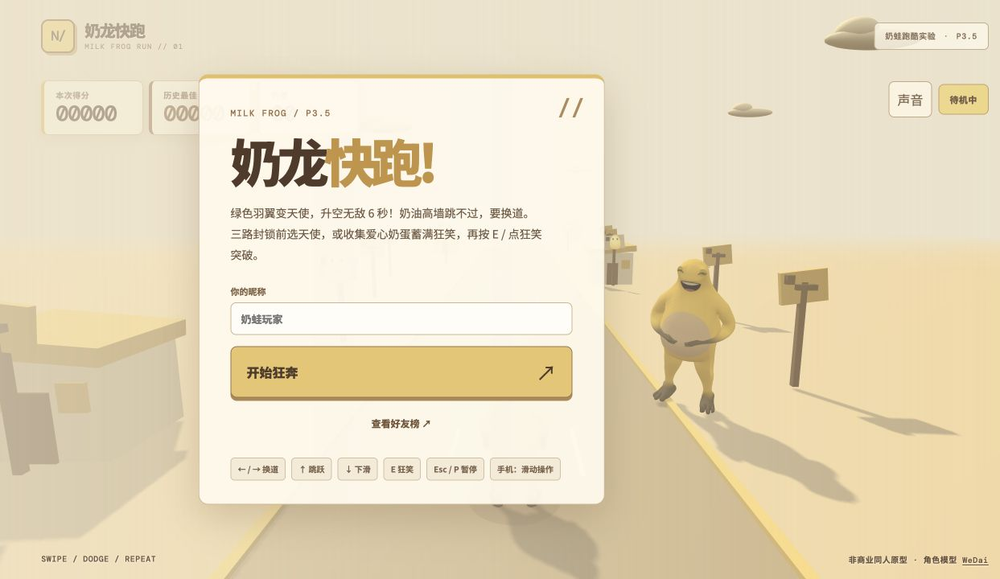

<div align="center">

# 奶龙快跑 · MILK FROG RUN

**收集奶蛋，抱腹狂笑，变成天使飞过奶油高墙。**

[▶ 立即开跑](https://nailong-run-club.github.io/nailong-run/) · [反馈问题](https://github.com/nailong-run-club/nailong-run/issues)

3D 三跑道跑酷 · 键盘 / 手机滑动 · 非商业同人



</div>

## 这是什么？

一个和朋友一起挑战分数的网页小游戏。黄色奶蛙在奶油小镇狂奔，穿过饼干箱、擀面杖横梁和奶油高墙。白、黄、棕的暖色场景，配上奶蛋、狂笑和天使模式，打开网页就能玩。

## 三种奔跑方式

| 状态 | 玩法 |
| --- | --- |
| 普通奶蛙 | 左右换道、跳跃、下滑，收集奶蛋与能量 |
| 狂笑冲刺 | 能量满后主动发动，持续 4 秒，加速并撞开障碍 |
| 白色天使 | 吃到绿色羽翼后升空，白色皮肤、光环和羽翼，飞行约 6 秒；下降及落地缓冲期间也受保护 |

奶蛋增加分数和能量，爱心奶蛋提供更多奖励。三路高墙前有天使与能量补给，可以选择自己的突破路线。

## 怎么操作

| 动作 | 电脑 | 手机 |
| --- | --- | --- |
| 左右换道 | ← / → 或 A / D | 左右滑动 |
| 跳跃 | ↑ / W / 空格 | 上滑 |
| 下滑 | ↓ / S | 下滑 |
| 狂笑 | 能量满后按 E | 点“狂笑” |
| 暂停 / 继续 | Esc / P | 右上角暂停按钮 / 菜单继续 |

**手机换道使用滑动，点按画面不会换道。**

## 障碍要怎么看？

| 障碍 | 应对方法 |
| --- | --- |
| 饼干箱 | 跳跃或换道 |
| 擀面杖横梁 | 下滑或换道 |
| 奶油高墙 | 换道，或使用天使 / 狂笑；普通跳跃和下滑不能穿过 |
| 三路封锁 | 提前选择绿色天使或爱心补给路线，利用能力突破 |

## P3.5.2：无上限加速与连续动作挑战

- **300 米后**加入设计好的三拍组合：“跳跃 → 换道 → 下滑”和“下滑 → 换道 → 跳跃”。
- **900 米后**组合出现得更频繁；800 米后的普通障碍组也会更多地占据两条道路。
- **持续提速，没有速度上限**：前 20 秒保留快速热身，随后继续平滑加速；狂笑时额外加速 8。越坚持，速度越快。
- 高速下按速度安排连续动作、封锁补给和前方视距，避免障碍生成到玩家脚下。
- 组合仍按速度留出动作恢复时间，三路能力封锁前保留可达补给。
- 想拿高分，除了反应速度，也要看清接下来的动作顺序。

此前已修复回车重复开局、排行榜内误启动、长按暂停反复切换，以及横屏菜单裁切和能量条遮挡等问题。

## 和朋友比一比

填写昵称后开始游戏，结束时尝试上传成绩；好友榜保留每个浏览器身份的最高分。自己的历史最佳也保存在当前浏览器。联网失败时仍可以继续玩。

开局次数使用独立的匿名浏览器标识统计，管理员统计页需要登录并校验权限，游戏无需登录。浏览器标识不等于准确人数；清除存储、换浏览器或无痕浏览可能产生新身份。

## 技术与本地预览

使用 **Vite + TypeScript + Three.js** 开发。该 GitHub 仓库当前保存的是可直接部署的单文件发布版，不包含完整 TypeScript 开发目录。

下载仓库后，可在目录中启动静态服务：

```bash
python3 -m http.server 8000
```

随后访问 `http://localhost:8000`。排行榜等联网能力依赖在线服务及其访问设置，本地预览主要用于查看游戏。

## 素材与致谢

- 角色模型：[WeDai / bigdiu/naiwa-nailoong-blender-model](https://github.com/bigdiu/naiwa-nailoong-blender-model)。本项目将原 Blender 模型转换为网页模型，并添加动画、曲面贴合表情与天使材质。
- 笑声音源：[M1xqq/nailong-laugh](https://github.com/M1xqq/nailong-laugh)。为网络二创梗笑声，并非版权方官方配音。
- 奶蛋、羽翼轮廓、障碍与场景由项目绘制或通过几何体生成。

本项目用于学习与朋友间非商业娱乐，并非奶龙官方作品。角色、声音及第三方素材的权利归各自权利人；本仓库不授予这些素材额外的使用授权。

## 反馈

遇到问题欢迎提 Issue，附上手机 / 电脑型号、浏览器、出现前的操作及截图，会更容易定位。
